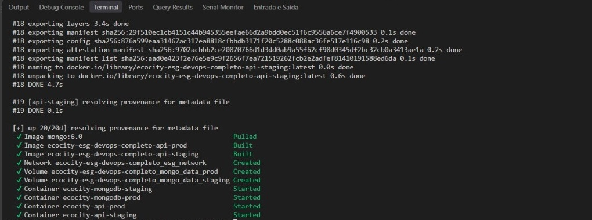
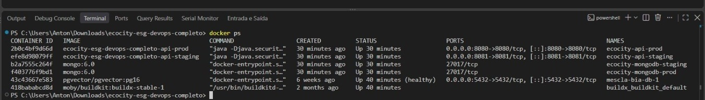
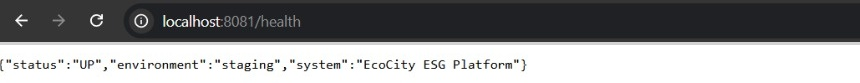
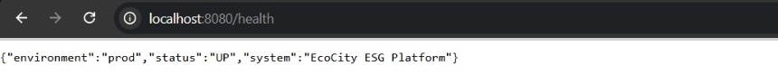
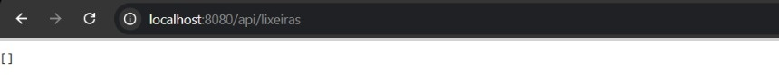
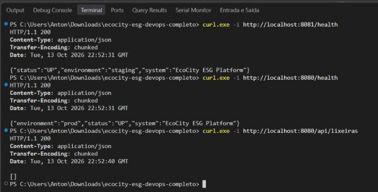

# Projeto - Cidades ESG Inteligentes (EcoCity)

API REST desenvolvida em Java Spring Boot integrada ao MongoDB para otimização da gestão de resíduos sólidos e rotas de coleta sustentáveis em centros urbanos.

## Integrantes

| Nome | RM |
| :--- | :--- |
| Ana Paula Santana Dos Santos | RM565721 |
| Enzo Lazarini de Godoy | RM564717 |
| Heitor Dos Santos Denser | RM562660 |
| Jean Alisson de Moraes Caldeira | RM564972 |

## Estrutura do projeto

```
ecocity-esg-devops-completo/
├── Dockerfile                      # Multi-stage build da aplicação
├── docker-compose.yml              # Orquestração: staging + produção + bancos
├── .env.example                    # Modelo de variáveis de ambiente
├── .dockerignore
├── .gitignore
├── pom.xml
├── README.md
├── .github/
│   └── workflows/
│       └── ci-cd.yml               # Pipeline CI/CD (GitHub Actions)
├── docs/
│   └── img/                        # Evidências de execução (prints)
└── src/
    ├── main/java/com/ecocity/      # Application, controllers, model, repository
    ├── main/resources/             # application.yml + profiles staging/prod
    └── test/java/com/ecocity/      # Testes automatizados (JUnit 5)
```

## Como executar localmente com Docker

1. Clone o repositório ou descompacte o arquivo ZIP e acesse a raiz:
   ```bash
   cd ecocity-esg-devops-completo
   ```

2. Crie o arquivo de ambiente a partir do modelo:
   ```bash
   cp .env.example .env
   ```

3. Suba toda a infraestrutura com Docker Compose:
   ```bash
   docker compose up -d --build
   ```

4. Verifique os contêineres ativos:
   ```bash
   docker ps
   ```

5. Acesse os endpoints para validação:
   - **Staging**: `http://localhost:8081/health` ou `http://localhost:8081/api/lixeiras`
   - **Produção**: `http://localhost:8080/health` ou `http://localhost:8080/api/lixeiras`

6. Para encerrar os serviços e limpar os volumes:
   ```bash
   docker compose down -v
   ```

> As senhas e portas são lidas do arquivo `.env`. Caso ele não exista, o Compose aplica
> automaticamente os valores padrão definidos em `docker-compose.yml`.

## Pipeline CI/CD

O pipeline foi construído com **GitHub Actions** (`.github/workflows/ci-cd.yml`) estruturado em três etapas automatizadas:

| Etapa | Gatilho | O que faz |
| :--- | :--- | :--- |
| **Build & Test** | push/PR em `main` e `develop` | Configura o JDK 17 (Temurin) com cache do Maven, compila o código, executa a suíte JUnit 5 e publica o artefato `.jar`. |
| **Deploy Staging** | `develop` ou `main`, após o build | Sobe `mongodb-staging` + `api-staging` via Docker Compose e valida o `/health` na porta `8081` com retentativas. |
| **Deploy Produção** | exclusivamente `main`, após staging | Sobe `mongodb-prod` + `api-prod`, valida o `/health` na porta `8080` e o endpoint de negócio `/api/lixeiras`. |

Pontos de robustez implementados:

- **Health check com retentativas** (30 tentativas a cada 5s) em vez de espera fixa, evitando falsos negativos enquanto a JVM e o MongoDB inicializam.
- **Promoção encadeada**: `deploy-production` depende de `deploy-staging`, que depende de `build-and-test`. Uma falha em qualquer etapa interrompe a promoção.
- **Coleta de logs automática** (`docker compose logs`) quando o health check falha, facilitando o diagnóstico.
- **GitHub Environments** (`staging` e `production`) separando contextos e segredos de cada ambiente.

## Containerização

O projeto utiliza a estratégia de **Multi-Stage Build** no `Dockerfile`:

- **Estágio 1 (builder)**: baseado em `maven:3.9.6-eclipse-temurin-17`, resolve as dependências em camada própria (`dependency:go-offline`, aproveitando o cache do Docker) e compila a aplicação gerando o executável.
- **Estágio 2 (runtime)**: utiliza a imagem enxuta `eclipse-temurin:17-jre-alpine`, contendo apenas a JRE. É criado um usuário sem privilégios de root (`appuser`) para mitigar vulnerabilidades de segurança e reduzir o tamanho final da imagem.

Na orquestração (`docker-compose.yml`):

- **Redes**: rede bridge dedicada `esg_network`, permitindo que a API resolva o banco pelo nome do serviço (`mongodb-staging` / `mongodb-prod`) em vez de `localhost`.
- **Volumes**: `mongo_data_staging` e `mongo_data_prod`, independentes, garantindo persistência e isolamento total de dados entre os ambientes.
- **Variáveis de ambiente**: credenciais, nome do banco e portas externalizados via `.env` (modelo em `.env.example`), com valores padrão de fallback.
- **Health checks**: o MongoDB é verificado com `db.adminCommand('ping')` e a API só inicia após o banco estar saudável (`depends_on: condition: service_healthy`).

## Prints do funcionamento

### Evidência 1 — Build das imagens e subida da stack (`docker compose up -d --build`)

Construção das imagens `api-staging` e `api-prod`, criação da rede `esg_network`, dos volumes `mongo_data_staging` / `mongo_data_prod` e inicialização dos quatro contêineres.



### Evidência 2 — Contêineres ativos (`docker ps`)

Os quatro contêineres do projeto em execução: `ecocity-api-prod` (8080), `ecocity-api-staging` (8081), `ecocity-mongodb-staging` e `ecocity-mongodb-prod` (ambos isolados na rede interna, sem exposição ao host).



### Evidência 3 — Ambiente de Staging ativo (`localhost:8081/health`)

Resposta do health check confirmando o profile `staging` carregado corretamente.



### Evidência 4 — Ambiente de Produção ativo (`localhost:8080/health`)

Resposta do health check confirmando o profile `prod` em execução simultânea e isolada do staging.



### Evidência 5 — Endpoint de negócio em Produção (`localhost:8080/api/lixeiras`)

Consulta à coleção `lixeiras_inteligentes` no MongoDB de produção, retornando a base íntegra e vazia — comprovando o isolamento de estado em relação ao ambiente de staging.



### Evidência 6 — Validação dos dois ambientes via `curl`

Retorno `HTTP/1.1 200` e `Content-Type: application/json` nos três endpoints validados (`8081/health`, `8080/health` e `8080/api/lixeiras`), confirmando o deploy simultâneo e funcional em staging e produção.



## Tecnologias utilizadas

- **Linguagem & Framework**: Java 17, Spring Boot 3.2.5 (Spring Web, Spring Data MongoDB, Actuator)
- **Banco de Dados**: MongoDB 6.0
- **Testes**: JUnit 5 (Jupiter)
- **Build**: Apache Maven 3.9.6
- **Containerização**: Docker Engine, Multi-Stage Dockerfile
- **Orquestração**: Docker Compose v2
- **CI/CD**: GitHub Actions
- **Controle de Versão**: Git / GitHub

## Checklist de entrega (obrigatório)

| Item | OK |
| :--- | :---: |
| Projeto compactado em .ZIP com estrutura organizada | ☑ |
| Dockerfile funcional | ☑ |
| docker-compose.yml ou arquivos Kubernetes | ☑ |
| Pipeline com etapas de build, teste e deploy | ☑ |
| README.md com instruções e prints | ☑ |
| Documentação técnica com evidências (PDF ou PPT) | ☑ |
| Deploy realizado nos ambientes staging e produção | ☑ |
